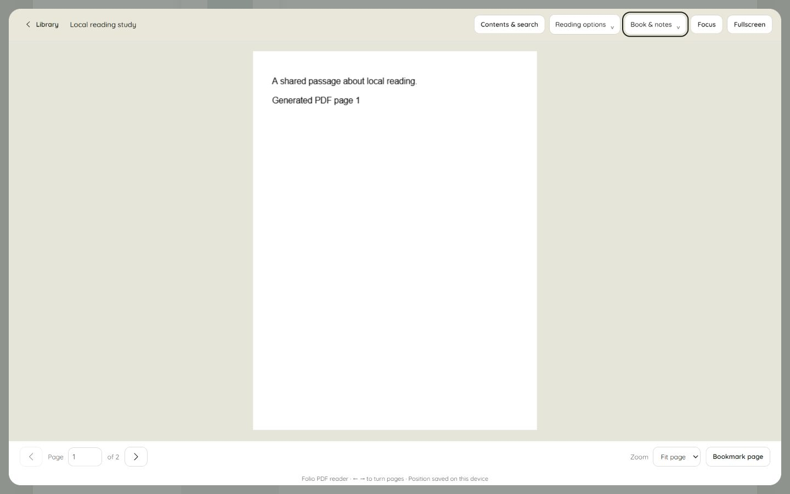

# Folio · Local-first ebook reader

An open-source reader for **PDF, EPUB, CBZ and naturally ordered image collections**. Browse real cover art, resume where you stopped, organize collections, save notes and read offline. Your books and reading data stay on your device.

[](https://github.com/AceAligora/folio-local-reader/actions/workflows/check.yml)
[](LICENSE)

## Download for Windows

Get the Windows x64 installer from [GitHub Releases](https://github.com/AceAligora/folio-local-reader/releases/latest). The installer is unsigned and installs per user without administrator access. Installed copies check for new stable releases automatically; use the native **Updates** menu to change that setting. Your books and reading data stay local. Portable ZIPs and source builds update manually.

## Run from source

Install **Node.js 24.14 or newer**, then:

```sh
git clone https://github.com/AceAligora/folio-local-reader.git
cd folio-local-reader
node server.mjs --open
```

No npm installation, account or cloud service is required. Open the loopback URL printed in the terminal, normally `http://127.0.0.1:4317/`, and choose your ebook folder in Folio. On Windows you can also double-click **Start Reader.cmd**. Keep the server running while reading.

Folio binds to `127.0.0.1`; do not expose its port publicly or through a tunnel. Optional online discovery, metadata and chapter-feed tools are off by default. They require your explicit opt-in; the local library remains available offline.

## What works

- Embedded PDF, EPUB, image-book and CBZ readers with saved position, mouse-wheel navigation and flexible layouts.
- Cover grid, list and descriptive views; collections, favorites, reading queue, history and reading insights.
- A local Discover bookshelf with continue-reading covers, search and category shelves.
- Local notes, colored highlights, bookmarks, PDF search and a searchable reading notebook.
- Light, dark and sepia themes; separate settings pages and responsive navigation.
- Folder watching, duplicate review, local text indexing and recovery backups.
- Optional Windows OCR, installed offline voices and an Electron desktop build.
- Installed Windows automatic updates from published GitHub Releases, with verified downloads and a save-before-restart installation step.
- Opt-in source adapters and RSS/Atom chapter feeds, with explicit downloads stored locally.



The screenshot uses a generated document; no personal ebooks or profiles are included. See [feature completion and limits](docs/FEATURE-COMPLETION.md) for format-specific behavior and outstanding platform work.

## Contribute and build

```sh
node scripts/check.mjs
node --test
```

See [CONTRIBUTING.md](CONTRIBUTING.md), [architecture](docs/IMPLEMENTATION.md), [UI design](docs/UI-DESIGN.md), [security](SECURITY.md) and [third-party notices](NOTICE). Original Folio code is licensed under **Apache-2.0**; bundled components retain their own licenses. Contributions are welcome through issues and pull requests. Never include personal books, profiles, credentials or private screenshots.

The current release is **0.10.0**. Windows installers, portable ZIPs and checksums are distributed in [GitHub Releases](https://github.com/AceAligora/folio-local-reader/releases), while the repository contains source. Tagged versions run the Windows release workflow before publication. See [distribution and updater details](docs/DISTRIBUTION.md).

## Detailed feature notes · 0.9.0

See the [completion ledger](docs/FEATURE-COMPLETION.md) for working features, limits and unfinished platform work. This release adds RSS/Atom serialized chapter feeds, offline chapter EPUBs with series navigation, and opt-in temporary source sessions for manual sign-in/challenges in Desktop. The browser version remains available. Network access, automatic source checks and file-content comparisons remain off by default.

### Windows desktop preview

Run **Folio-Setup-0.9.0-windows-x64-unsigned.exe**, or extract the desktop ZIP and double-click **Folio.exe**. The installer needs no administrator access. Its optional Open with component defaults off and never replaces your current default reader. Uninstall keeps your library and profile. This release is unsigned by choice; see [distribution and verification](docs/DISTRIBUTION.md). No Node/npm installation is needed. Desktop uses the same local library/profile as the browser version. It verifies and reuses an already running Folio server, or starts its bundled local server. Closing Desktop saves reader state first and stops only a server that Desktop started. A reused browser server stays running. An older running server may need restarting with this release.

Settings → Security enables Windows screen-capture exclusion; it defaults off and is separate from the inactive-window privacy screen. Settings → Reader → Keep screen on uses a native display wake blocker while actively reading in a focused window. Settings → Appearance controls Windows taskbar reading progress. Native-only controls are disabled in the browser. Use **Folio → Open ebook…** (Ctrl+O), or choose Folio from Windows Open with if registered, for PDF/EPUB/CBZ files. Existing library books resume; outside files are copied into the configured local library. Originals remain untouched. See [desktop architecture, build and limitations](docs/DESKTOP.md).

### Serialized chapters and source sessions

Settings → **Chapter feeds** follows author-published RSS 2.0 or Atom feeds. Add the bundled Chapter feeds adapter, follow a feed, then choose Check chapters when optional networking is enabled. Updates also lists followed series. Save individual chapters as separate local EPUBs grouped by series/collection; cached full-content chapters can be saved offline. Read/unread filters, revised-copy downloads, local previous/next chapter controls and optional background checks are included. Existing ebooks are never replaced. The Wandering Inn feed is offered as a form suggestion; adding it and downloads remain your choice.

Settings → **Source sessions** enables temporary cookies. In Desktop, open a source window, handle any sign-in/challenge yourself, then choose **Source session → Use this session in Folio** and retry. Cookies stay in memory for at most eight hours and are cleared by app lock, Incognito, network/session opt-out, User Agent changes or server restart. Source windows have no library bridge and cannot access local-network destinations. There is no automatic CAPTCHA/Cloudflare bypass or guarantee that a site's challenge accepts a cookie replay. [Supported feed formats, limits and session behavior](docs/CHAPTER-FEEDS-AND-SESSIONS.md).

### Source updates

Settings → Source updates has an explicit Save button for background checks, a 1–168 hour interval, metadata/cover policies, title preservation and category exclusions. Updates shows linked books and pending changes. Downloaded Gutenberg books and books with applied Open Library metadata are recognized by their source IDs. Checks send these IDs, not ebook bytes or the full library. Disabled/removed adapters, unavailable/excluded books and Incognito skip checks.

Automatic checks run in the local server without an open browser, in batches of at most 10 oldest-due links, paced two seconds apart. Metadata defaults to review; optional automatic refresh changes only metadata still owned by that source and keeps titles by default. Reviewed metadata can be applied offline. Cover application requires networking, validates image bytes, and saves a separate local cover. Automatic cover refresh updates missing/source-managed covers and preserves manual covers. A stale metadata review or changed cover is rejected rather than overwriting a new local edit. Dismissed revisions remain dismissed until the source data changes; per-book pause/resume is persistent.

Enable **manual EPUB and cover content comparisons** in Source update preferences, save, then choose **Compare file contents** on one linked book in Settings or Updates. The first successful comparison establishes a baseline; later comparisons detect SHA-256 changes at the same URL. This compares successive remote responses, not the remote edition against your local ebook. Background/regular checks never download assets for comparison. Each comparison is limited to 20 MiB for a Gutenberg EPUB and 5 MiB for its cover (Open Library provides covers only). Bytes are discarded after hashing; the baseline stays local. The compared date is shown beside each baseline.

Changed EPUBs produce a notice; Folio never replaces an existing ebook or transfers its page position to another edition. Open source details to obtain a separate updated file. Cover revisions use the existing review/protected refresh policies, with a digest guard rejecting a cover that changed after review. Errors, cancellation, unsupported responses and size-limit failures retain the last successful review. SHA-256 changes can reflect format regeneration rather than new chapters; these adapters provide complete editions/work metadata, not chapter feeds. Reading-data JSON restore cannot enable content comparison, automatic refresh or automatic apply policies; full-profile backup includes source links/reviews/baselines.

### Folders and EPUB resume

Settings → Library → Folders & scanning controls folder-listing reuse (enabled by default), automatic folder collections (off by default), and excluded relative folder paths, one per line. Exclusions include subfolders, hide matching books from the library, and leave originals and reading data intact. Removing an exclusion restores those records. Automatic collections include books in each folder and its descendants, update as files change, and cannot be edited; manual collections remain independent.

Incremental scans reuse listings when a directory's modification/change timestamps match, but still inspect individual files and traverse children to detect content edits. Run full library scan bypasses the listing cache; use it after tools that preserve directory timestamps. Folder watching is a separate setting that groups local file changes into scans.

EPUB resume stores the chapter path, character offset and surrounding text. Resizing, zooming and reopening restore the same passage, even when earlier text was inserted. If the passage was removed or rewritten, chapter/scroll remains the fallback. These anchors are local to Folio, not standard EPUB CFI interchange.

### Full-profile recovery

Settings → Storage & advanced → Export full profile archive includes the database, covers, cached packages, dictionary and lock configuration. It excludes original ebooks. Keep this archive private. The expanded archive limit is 256 MB; larger profiles need an offline filesystem backup.

Stop Folio before restoring a full archive. From the source checkout, run `node scripts/restore-profile.mjs backup.zip profile-directory`. An optional third argument selects a new ebook directory. The tool verifies paths/checksums and retains the old profile in a `before-restore` directory. Reading-data JSON can be reviewed/restored inside the running app by matching relative book paths.

### Portable Windows preview

Run `node scripts/build-portable.mjs` to create an allowlisted distribution under `.local/dist/`, including the current Node runtime and its official license. The build fetches that runtime version's license unless `NODE_LICENSE_FILE` points to a local copy. Double-click Start Folio.cmd in the built folder; a Node/npm installation is unnecessary. This opens the reader in a browser. An optional desktop installer is available separately; code signing is deferred.

### Offline reading tools

Contents & search → Offline reading tools provides Windows OCR, installed offline speech voices and a local JSON dictionary. OCR uses installed Windows languages. Speech synthesizes up to 6,000 characters per Windows request. Dictionary files map words to definitions and are limited to 2 MB. Temporary OCR/audio files are cleaned after processing.

### Native online sources

Settings → Sources & extensions → Native adapters manages reviewed adapters included with Folio. Add/remove/update actions work offline; new adapter code ships in Folio releases, rather than executing downloaded packages. Removing an adapter keeps books, metadata, preferences and cached searches. Full-profile archives include adapter configuration; reading-data JSON exports focus on reading records and general preferences.

The Gutenberg adapter uses the [Gutendex catalogue](https://gutendex.com/) and explicit EPUB downloads. Update the bundled adapter to v2 to unlock language filtering, sorting and pagination. Open Library adds work discovery and explicit metadata application to a chosen local book; it does not download ebooks. Its language preference ranks editions rather than excluding other languages. Cached searches can be read, and cached metadata explicitly applied, while network access is off or an adapter is removed. Each page/query/language/order/page-size combination has its own cache.

Android catalogues remain discovery/package caches only; APK code is never executed. See the [adapter contract and limits](docs/NATIVE-SOURCES.md).

The earlier overview below describes the original preview; the completion ledger supersedes its feature status.

A local-first ebook library preview for PDFs, EPUBs, and ordered image collections. The interface uses the working name Folio.

Runs on localhost with Node.js 24.14 or newer. Double-click **Start Reader.cmd** on Windows, or run `node server.mjs --open`. Configure your ebook folder in the interface. No dependency installation is needed. See [setup and current limitations](docs/IMPLEMENTATION.md).

Image reading, an embedded PDF.js reader, and a simplified EPUB chapter reader are available. PDFs display first-page cover thumbnails. Favorites, reading status, named bookmarks, zoom, fullscreen, and saved page/chapter position are included. Windows desktop packaging is available in this release.

## Workspace overhaul

The current Library uses a compact cover grid with an A–Z index. Mouse-wheel page navigation is enabled by default. Optional catalogue/metadata network tools live under Settings → Sources & extensions; [all books and reading data remain local](docs/NETWORK-AND-LOCAL-FIRST.md).

Library, Updates, History and Settings organize the interface. Browse is under Settings → Sources & extensions. Settings has separate category pages, and PDFs/images support single/double/automatic page layouts. Last-position resume is enabled by default. [Implemented features and remaining specification](docs/WORKSPACE-OVERHAUL.md) documents local update detection, filters/sorts/displays, categories, reading insights, preferences and extension compatibility limits.

## Planning documents

- [Product roadmap](docs/ROADMAP.md): scope, delivery stages, and release criteria.
- [Architecture plan](docs/ARCHITECTURE.md): components, local data, file access, and reader boundaries.
- [Phase 1 implementation plan](docs/PHASE-1.md): ordered tasks and acceptance checks for foundation and import.

## Project boundaries

- Original ebooks remain unchanged. Metadata, thumbnails, notes, and progress live separately.
- Library locations are configured locally and never committed.
- Synced material under `sources/` is read-only reference material.
- Original project code is licensed under [Apache-2.0](LICENSE). Review bundled third-party notices before adding dependencies or publishing releases.
- Roadmap documents describe the target; `docs/IMPLEMENTATION.md` distinguishes working features from outstanding work.

### Adding books and collections

Use **Add books** in the sidebar to open the Add items dialog and select PDF/EPUB/CBZ/image files or a folder. Files are copied over localhost into a unique `Folio Imports/Import …` subfolder of your configured library. Folder structure is preserved; images sharing a folder form one book in natural filename order. Original files are never overwritten. Imports are staged in the local profile until the entire batch succeeds (1 GB per file, up to 10,000 files). If a file fails, the staged batch is discarded. After importing, Folio rescans the library and clears view filters so the new items are visible.

Use **New collection** in the sidebar to name a virtual collection and select books. The Collection selector above the library opens it; **Edit collection** renames it or changes membership. Books can belong to multiple collections without moving files or changing categories. Deleting a collection keeps its books. Collections persist in the local database and are included in backup exports.

### Contents and PDF Find

Open a book and choose **Contents & search** for PDF outlines or EPUB chapters. In a PDF, use **Find** (or Ctrl+F / Command+F) to search local embedded text and jump to a matching page. Scanned images need OCR; matching PDF text items are highlighted locally. Search stops at 200 matching pages or 10,000 checked pages and can be cancelled.
